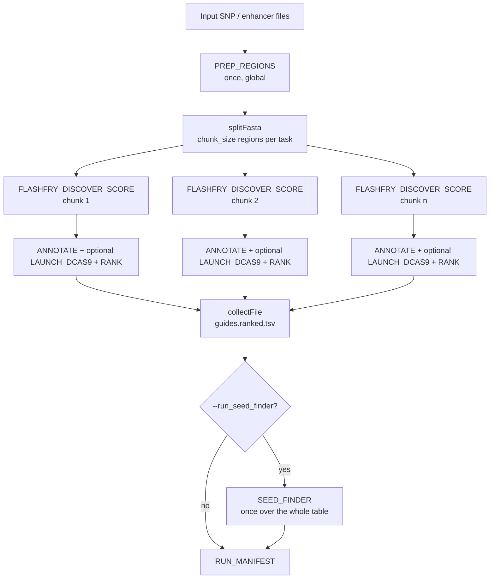

# Scaling and clusters

creTarget is built for a laptop and for a genome-wide run on a shared cluster.
The scheduler is a profile, not a separate code path. This page covers the
execution model, the knobs that matter, and the measured performance. The
step-by-step first install on a new cluster is in the
[cluster walkthrough](../cluster-setup.md).

## Profiles

Combine an execution profile with a software profile:

```bash
nextflow run MikeKazz/creTarget -profile slurm,conda ...
```

| Execution | Software |
|---|---|
| `local`, `standard` | `conda`, `mamba`, `micromamba` |
| `slurm` | `docker` |
| `pbs` (PBS Pro) | `singularity` |
| `sge` | `apptainer` |
| `lsf` | — |

The `conda`, `mamba`, and `micromamba` profiles all build the same pinned
environment from `assets/environment.yml`; `mamba` and `micromamba` only change
the solver. The container profiles use `ghcr.io/mikekazz/cretarget:0.5.1` by
default; override with `--container_image`.

> A container profile with no image is a hard error. Running with an engine
> enabled and no image would silently execute against host tools while the run
> reports a container, which is worse than failing.

## The execution model

Only `PREP_REGIONS` is global. It parses every target, validates contigs, and
extracts the padded windows. Everything after it is per chunk:



Per-chunk ranking is equivalent to global ranking because every guide for a
`region_id` lands in the same chunk. That is what keeps memory flat: 3,000
regions and 2.35 million regions use the same per-task memory, only the task
count changes. CI verifies that two independent runs with different work
directories produce byte-identical output.

## Chunk size

`--chunk_size` is regions per task. It trades scheduling overhead against the
cost of a retry:

- Smaller chunks parallelize better and retry faster.
- Larger chunks reduce scheduling overhead but make a failed task more
  expensive.
- FlashFry runtime is superlinear in regions per chunk (measured
  `T ~ n^1.32`), so very large chunks are not the win they look like.

The default is 5,000. On a busy cluster, prefer fewer, larger tasks; on an idle
one, the reverse. The genome-wide benchmark used 1,000.

Nextflow also throttles concurrent submissions (`executor.queueSize`, default
50 in the cluster profiles) so a genome-wide run does not put thousands of JVMs
onto a shared filesystem at once. Raise it only if your site can take it.

## Resources and retries

Defaults live in `conf/base.config`; ceilings live in `conf/limits.config`:

| Parameter | Default | Meaning |
|---|---:|---|
| `--max_cpus` | 16 | Hard ceiling after all profiles and retries |
| `--max_memory` | 128 GB | Hard ceiling |
| `--max_time` | 48 h | Hard ceiling |
| `maxRetries` | 2 | Retries for OOM-killed, timed-out, or scheduler-limited tasks |

Requests escalate with `task.attempt`: a retry gets more memory, CPUs, and time
up to the ceiling. FlashFry's JVM heap is derived from the task's actual memory
allocation, so a retry at 2× memory automatically gets a 2× heap. `RANK`,
`ANNOTATE`, and the manifest are single-CPU tasks; `FLASHFRY_DISCOVER_SCORE` is
the memory-heavy one.

If a request escalates past what a partition will grant, the task is rejected
rather than queued. Lower the ceilings in a site profile to the largest single
allocation the partition allows.

## Resume

Add `-resume` to every invocation:

```bash
nextflow run ... -resume
```

A run that dies at hour 20 picks up from the last completed chunk. The cache is
keyed by inputs and parameters, so changing a parameter invalidates only the
tasks it affects. Keep the same work directory (`-w`) if you move the run.

## Container or conda

The container is the most portable option: one image, no dependency solve, no
version skew between users.

```bash
nextflow run MikeKazz/creTarget -r v0.5.1 \
    -profile slurm,singularity \
    --container_image ghcr.io/mikekazz/cretarget:0.5.1 \
    ...
```

The conda profile builds the same pinned environment from
`assets/environment.yml`. If the classic solver is slow, use
`-profile micromamba`.

Both profiles require the reference files to be visible from compute nodes. Set
`CRETARGET_CACHE_DIR` to a shared path, or pass absolute paths.

## Site profiles

The built-in profiles are generic. A site profile is needed only when the
cluster has constraints the scheduler cannot express: it does not account for
memory when placing jobs, does not enforce the memory it granted, or shares
nodes with work the scheduler cannot see.

- `conf/site-template.config` is a commented blank to copy.
- `conf/example-singlenode.config` is a filled-in example for a single-node
  SLURM cluster with shared GPUs, where the scheduler accounts for memory but
  does not enforce it. Its numbers are measured and the reasoning is inline.
- `assets/inspect_cluster.sh` is a read-only survey that reports scheduler
  configuration, filesystem types and locking, GPU capabilities, and any
  reference data already on disk.

Register a site profile in `nextflow.config`, or keep it outside the repository
and pass `-c /path/to/mysite.config`. The latter avoids carrying a local edit in
git.

## Submitting the driver

On a cluster, submit the Nextflow driver as a batch job. Keep its request
**minimal** (1 CPU, a few GB): the driver only waits, and every resource it
holds is one the actual work cannot have. On a single-node cluster, asking for
8 CPUs and 80 GB can deadlock while waiting for jobs that can never be
scheduled.

`assets/run_cretarget.sbatch` is a worked template, including the
`source conda.sh` step that batch jobs need because `conda activate` does not
work in a non-interactive shell.

## Storage

For a genome-wide cCRE run, budget roughly:

| Item | Size |
|---|---|
| Reference (download + decompressed FASTA) | ~6.5 GB |
| Work directory | ~300 GB |
| Final output | ~50 GB (~10 GB gzipped) |

The work directory is the big one. `-resume` depends on it, so do not delete it
until the run is complete and the output is archived. The output table is
streamed by `collectFile`, not held in memory.

## Measured performance

A full ENCODE cCRE run on a single node (20 physical cores / 40 threads,
125 GB RAM, NFS) under SLURM:

| | |
|---|---|
| Input | 2,348,854 cCREs (GRCh38, all classes) |
| Wall time | ~24 h |
| Guides produced | 92,519,254 |
| Regions with ≥1 usable guide | 2,337,508 (99.52%) |
| Guides per region | min 1, max 205, mean 39.4 |
| Passing hard filters | 67,850,895 (73.3%) |
| Output table | 50 GB (~10 GB gzipped) |
| Scheduler jobs | 7,049, zero failures or retries |
| Peak memory per task | 2.7 GB (FlashFry), 5.2 GB (region prep) |

Configuration: `chunk_size 1000`, 10 concurrent FlashFry tasks at 6 GB each.
Scaling is close to linear in region count, so a 10,000-region design takes
minutes rather than hours. Concurrency, not chunk size, is the main throughput
lever.

## Next steps

- [Cluster walkthrough](../cluster-setup.md) — survey, install, smoke test,
  site profile, scale up.
- [Pipeline parameters](../reference/parameters.md) — every flag.
- [Output files](outputs.md) — what to archive.
