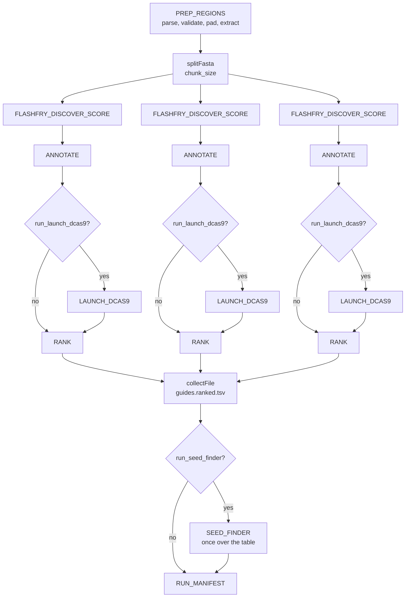

# Architecture

creTarget has two layers:

- **Python package** (`src/cretarget/`) — parsing, sequence handling, scoring,
  ranking, seed scanning, fetching, and diagnostics. Each step is independently
  runnable through `cretarget <step>`.
- **Nextflow pipeline** (`main.nf`, `workflows/`, `modules/`, `conf/`) — splits
  the work, schedules it, retries failures, and collates output.

The split is deliberate. The scientific logic is testable without a scheduler;
the scheduler is replaceable without rewriting the science.

## Workflow



## Modules

| Module | Scope | Responsibility |
|---|---|---|
| `PREP_REGIONS` | Once, global | Parse inputs, validate contigs, deduplicate names, flag linked targets, pad regions, extract sequence with `bedtools getfasta`, write metadata |
| `FLASHFRY_DISCOVER_SCORE` | Per chunk | FlashFry `discover` and `score` with JVM heaps derived from the task's memory allocation |
| `ANNOTATE` | Per chunk | Recover genome coordinates, join metadata, flag blast-radius hits, compute ATAC summit distance |
| `LAUNCH_DCAS9` | Per chunk, optional | Deduplicate spacers, invoke launch-dCas9 once per unique sequence, map predictions back |
| `RANK` | Per chunk | Hard filters, composite score, per-`region_id` rank |
| `SEED_FINDER` | Once, optional | Scan the promoter reference, stream hits, fold a per-guide summary back onto the table |
| `RUN_MANIFEST` | Once | Merge version blocks and write `run_manifest.json` |

## Why this shape

### Only region prep is global

Linked-target flagging needs every target at once, so `PREP_REGIONS` is global.
Everything after it is scoped to a chunk. The key invariant is that **every
guide for a `region_id` lands in the same chunk**, so per-chunk ranking is
exactly equivalent to global ranking. That is what keeps memory flat: a
2.35-million-region run uses the same per-task memory as a 3,000-region run,
only with more tasks.

### Collation is ordered by chunk index

`collectFile(sort: true)` orders by the Path's natural ordering, which is the
absolute path and contains the task's random work-directory hash. Two identical
runs would concatenate chunks in different orders and produce byte-different
output. creTarget sorts by the zero-padded numeric chunk index instead, so
"same input, same output" is true and testable. CI runs the pipeline twice with
different work directories and compares the tables.

### Seed screening runs once

The seed scan's cost is one pass over the promoter reference; it barely moves
with guide count. Running it per chunk paid that fixed pass on every chunk. It
therefore sits after collation and streams the table, holding only the seed
index in memory. `--seed_finder_max_guides` shards the table when memory is the
constraint.

### FlashFry memory is derived, not constant

FlashFry is a JVM tool and its heap must fit inside the task's allocation. The
module derives `-Xmx` from `task.memory`, so a retry at 2× memory gets a 2×
heap automatically. `discover` holds the index largely off-heap, so it gets a
smaller fraction of the allocation than a naive split would suggest.

### Containers fail closed

A container profile with no image is a hard error. Nextflow would otherwise run
every task uncontainerised, using whatever tools are on the host, while the run
reports a container and looks reproducible.

### Inputs fail with a diagnosis

The parser validates contigs against the `.fai` before bedtools sees them, so an
Ensembl-vs-UCSC mismatch produces a plain-language hint rather than a downstream
bedtools error. Malformed lines are skipped with warnings, not fatal, because
one bad line in a million-line file should not throw away the run.

## Repository layout

```text
main.nf                     pipeline entrypoint
nextflow.config             params, profiles, reporting, manifest
workflows/cretarget.nf      the workflow DAG
modules/local/              one Nextflow process per step
conf/base.config            per-process resources and retry escalation
conf/modules.config         publishing rules
conf/limits.config          resource ceilings, applied last
conf/site-template.config   commented blank for a new cluster
conf/example-singlenode.config
                            worked single-node SLURM example
conf/test.config            small-resource smoke-test profile
src/cretarget/              Python package
  steps/                    one module per processing step
  seed_scan.py              promoter-window scanner
  fetch.py                  explicit downloads and checksums
  doctor.py                 preflight checks
  config.py                 step-level CLI config
assets/                     cluster survey, sbatch template, conda env, verification
docs/                       documentation site (MkDocs Material)
wiki/                       concise GitHub wiki pages
tests/                      pytest suite
```

## Testing

- **Unit tests** (`tests/`) cover parsing, coordinate math, ranking, seed
  scanning, config, and banner behavior.
- **Integration tests** run the real step chain on a synthetic mini-genome.
  FlashFry is fabricated from its documented column set; the full FlashFry path
  is covered by the Nextflow smoke test.
- **Nextflow CI** builds a synthetic genome and a real FlashFry index, runs the
  pipeline with ATAC annotation and seed screening, checks both strands,
  multi-gene hits, signed distances, self-hits, provenance, and byte-identical
  output across two runs and `-resume`.
- **Version floor** is tested: Nextflow 24.04.4, a current production release,
  and latest-stable.

See [.github/workflows/ci.yml](https://github.com/MikeKazz/creTarget/blob/main/.github/workflows/ci.yml)
for the exact commands.

## Extending

A new step normally needs:

1. A Python module with `run(args)` and `add_arguments(parser)`.
2. A subcommand in `src/cretarget/cli.py`.
3. A Nextflow process in `modules/local/` that writes `versions.yml`.
4. Wiring in `workflows/cretarget.nf`.
5. Resources in `conf/base.config` and publishing in `conf/modules.config`.
6. Tests, output-column docs, parameter docs, and a changelog entry.

Keep per-chunk steps independent. If a step needs global state, say so
explicitly and document the memory implication.
